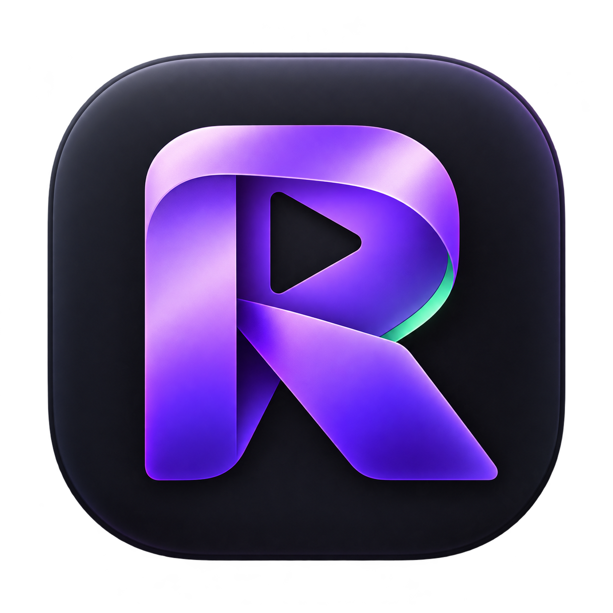

<p align="center">
  
</p>
<h1 align="center">REVA Studio</h1>
<p align="center">Record clearly. Edit beautifully. Keep it local.</p>
<p align="center">
  <a href="https://github.com/morf3uzzz/reva-studio/releases/tag/v0.1.1">Download for macOS</a> ·
  <a href="README.ru.md">Русский</a> ·
  <a href="docs/STATUS.md">Release status</a> ·
  <a href="https://github.com/morf3uzzz/reva-studio/issues">Report a bug</a>
</p>

REVA Studio is an independent, local-first screen recorder and video editor for
macOS. Capture a window, display or region, then shape the result with animated
zooms, camera scenes, captions, cursor effects and a shared audio mix.

**0.1.1 is a preview release.** Some hardware and permission-dependent paths
still need broader testing. See [known limitations](docs/STATUS.md).

## Download and install

| Download | Mac | Requires |
| --- | --- | --- |
| [Universal DMG](https://github.com/morf3uzzz/reva-studio/releases/download/v0.1.1/REVA-Studio-0.1.1-macOS-universal.dmg) | Intel and Apple Silicon | macOS 14+ |
| [Universal ZIP](https://github.com/morf3uzzz/reva-studio/releases/download/v0.1.1/REVA-Studio-0.1.1-macOS-universal.zip) | Intel and Apple Silicon | macOS 14+ |

1. Install **FFmpeg and ffprobe**. With an existing [Homebrew](https://brew.sh)
   installation: `brew install ffmpeg`.
2. Open the DMG and drag **REVA Studio.app** into **Applications**.
3. Launch the app. Grant Screen Recording, microphone or camera access when you
   choose to use those inputs. Input Monitoring is only needed for shortcut capture.

FFmpeg is **not bundled**. The app finds it in `/opt/homebrew/bin`,
`/usr/local/bin` or your `PATH`. It does not install dependencies automatically.
The preview builds use an ad hoc signature and are not Apple-notarized.
If macOS blocks opening, use Apple's supported **Privacy & Security → Open Anyway**
flow after reviewing the source and release checksums; no system-wide protection
changes are required. [Apple's instructions](https://support.apple.com/en-us/102445).

## What you can do

- **Record:** screen/window/area, independent microphone and camera, system or
  selected-app audio, pause/resume, countdown, flags and speaker notes.
- **Edit:** split, trim, restore gaps, change clip speed/volume, crop and undo.
  Navigate with J/K/L or audible scrubbing.
- **Compose:** automatic/manual/instant zooms, loupe, camera scene transitions,
  split/overlay/fullscreen layouts, local background removal and face following.
- **Style:** original REVA wallpapers, gradients, custom images, reusable presets,
  cursor artwork and click effects, shadows, device frames and preview guides.
- **Add text and audio:** local transcription, SRT, transcript-based edits,
  caption styles, music, narration, loop/ducking and microphone processing.
- **Protect:** manual masks/highlights and local OCR/face analysis. Review results:
  automatic detection can miss content.
- **Export:** H.264, HEVC or both, ProRes, GIF, clipboard image/video, raw media and
  portable projects. A local CoreML model provides optional 2× super-resolution.

No account or cloud upload is required. Optional Unsplash search needs your own
session API key and makes explicit network requests. Transcription is on-device;
unsupported permissions/languages return an error instead of a cloud fallback.

## Keyboard essentials

| Action | Shortcut |
| --- | --- |
| New recording / open / save | ⌘N / ⌘O / ⌘S |
| Search commands | ⌘K |
| Play / pause | Space |
| Cut / zoom | C / Z |
| Undo / redo | ⌘Z / ⌘⇧Z |
| Stop recording | ⌘⇧2 |

## Build from source

Use macOS 14+, Apple Command Line Tools, Node **24.18.0+**, npm and FFmpeg.

```sh
git clone https://github.com/morf3uzzz/reva-studio.git
cd reva-studio
npm ci
npm run assets
npm run model:fetch
npm run dev
```

`model:fetch` downloads three small files from a pinned public PiperSR revision
and validates SHA-256. The model carries its own CC BY 4.0 license; see
[third-party notices](THIRD_PARTY_NOTICES.md).

```sh
npm run build
npm run build:native
npm test
npm run test:editor-ui
npm run test:web-audio
npm run test:gpu
npm run test:native
npm run release:mac                         # Universal DMG + ZIP + SHA-256
npm run release:mac -- --arch=arm64          # Apple Silicon only
npm run release:mac -- --arch=x64            # Intel only
```

Release packaging downloads official, checksum-verified Electron distributions,
cross-compiles the Swift helper, merges both architectures and checks the resulting
Mach-O binaries. Files are written under `build/releases/`. Existing release
files are never silently overwritten. For a persistent signing identity, set
`REVA_CODESIGN_IDENTITY` to an existing valid certificate; notarization is separate.

## Project layout

```text
src/          React editor and shared preview renderer
electron/     Local media, project, export and window owners
native/       Swift capture, Vision, Speech and CoreML helper
shared/       Timeline, audio and persistence contracts
scripts/      Original assets, model fetch and macOS packaging
tests/        Editor and integration regressions
branding/     REVA identity
```

The repository contains only REVA Studio. It does not contain recordings, user
projects, development caches, the surrounding REA workspace or extracted vendor
artwork. Built-in art and sounds are independently generated. Screen Studio
project import supports a bounded subset; this project is not affiliated with
Screen Studio or Apple. Windows needs a separate native capture/analysis backend
and is not supported by this release.

## License

REVA source and original procedural assets: [MIT](LICENSE).
PiperSR model: **CC BY 4.0**, Ben Racicot / ModelPiper. Electron, React and Lucide
retain their own notices. See [THIRD_PARTY_NOTICES.md](THIRD_PARTY_NOTICES.md).
